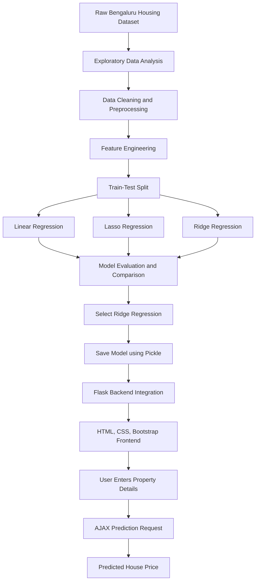

# 🏡 Bengaluru House Price Prediction

### Machine Learning | Regression Analysis | Flask Web Application

A Machine Learning-powered web application that predicts residential property prices in Bengaluru based on property characteristics such as location, BHK, number of bathrooms, and total square footage.

This project demonstrates an end-to-end Machine Learning workflow, from data preprocessing and exploratory data analysis to regression model comparison, model evaluation, serialization, and deployment through a Flask web application.

<p align="center">
  
  
  
  
  
  
</p>

---

## 📌 Project Overview

The objective of this project is to develop a predictive system that estimates house prices in Bengaluru using historical housing data.

The project explores multiple regression algorithms and compares their performance to identify a suitable model for house price prediction.

Three regression algorithms were implemented and evaluated:

- Linear Regression
- Lasso Regression
- Ridge Regression

After comparing the models, **Ridge Regression** was selected for the final prediction application.

## 📊 Model Performance

<p align="center">
  
  
</p>

| Evaluation Metric | Result |
|---|---:|
| Selected Model | Ridge Regression |
| Reported Accuracy / Score | **0.8294 (82.94%)** |

The Ridge Regression model achieved an evaluation score of 0.8294 (R² Score: 82.94%).

An R² score of 0.8294 indicates that the model explains approximately 82.94% of the variance in Bengaluru house prices on the evaluated dataset. This score represents regression performance and should not be interpreted as classification accuracy.

## ✨ Key Features

- **House Price Prediction:** Estimates property prices based on user-provided details.
- **Location-Based Prediction:** Selects from available Bengaluru locations.
- **Multiple Regression Models:** Implements Linear, Lasso, and Ridge Regression.
- **Model Comparison:** Evaluates regression models to select the final model.
- **Data Preprocessing:** Handles missing values, duplicates, inconsistent entries, and data transformations.
- **Feature Engineering:** Prepares relevant property features for model training.
- **Interactive Web Interface:** Simple and responsive frontend using Bootstrap.
- **Flask Integration:** Connects the trained ML model with a web application.
- **AJAX Requests:** Displays predictions without reloading the webpage.

## 🧠 Machine Learning Techniques Used

### 1. Exploratory Data Analysis (EDA)
- Understanding dataset structure and distributions.
- Identifying missing and duplicate records.
- Analyzing relationships between property features and house prices.
- Examining location-wise property information.
- Identifying inconsistencies and unusual values.

### 2. Data Preprocessing
- Handling missing values.
- Removing duplicate records.
- Cleaning inconsistent data.
- Converting categorical and numerical features into suitable formats.
- Preparing the dataset for regression modelling.

### 3. Feature Engineering
- Location-based feature representation.
- Processing total square footage.
- Selecting relevant independent variables.
- Preparing the feature matrix and target variable.

### 4. Regression Algorithms

| Algorithm | Purpose |
|---|---|
| Linear Regression | Establishes a baseline relationship between input features and house prices. |
| Lasso Regression | Applies L1 regularization to penalize coefficients and perform feature selection. |
| Ridge Regression | Applies L2 regularization to reduce overfitting and control large coefficients. |

### 5. Model Evaluation and Selection
- Comparing regression model performance.
- Evaluating the model using the reported score.
- Selecting Ridge Regression for the final application.
- Saving the trained model using Pickle.

## ⚙️ Technology Stack

| Category | Technologies |
|---|---|
| Programming Language | Python |
| Data Analysis | Pandas, NumPy |
| Data Visualization | Matplotlib, Seaborn |
| Machine Learning | Scikit-learn |
| Regression Algorithms | Linear Regression, Lasso Regression, Ridge Regression |
| Backend Development | Flask |
| Frontend Development | HTML5, CSS3, JavaScript |
| UI Framework | Bootstrap 5 |
| Asynchronous Communication | AJAX, XMLHttpRequest |
| Model Serialization | Pickle |
| Development Tools | Jupyter Notebook, VS Code, Git, GitHub |

## 🔄 Project Workflow



## 🖥️ Application Screenshots

### Home Page

Screenshots\Homepage.png
### Prediction Result

Screenshots\Prediction result.png

## 📁 Project Structure

```text
Bengaluru_House_Price_Prediction/
│
├── data/
│   ├── raw/
│   │   └── Bengaluru_House_Data.csv
│   │
│   └── processed/
│       └── Cleaned_data.csv
│
├── models/
│   └── RidgeModel.pkl
│
├── static/
│   ├── css/
│   │   └── style.css
│   │
│   └── images/
│       └── background.png
│
├── templates/
│   └── index.html
│
├── Notebook.ipynb
├── main.py
├── requirements.txt
├── README.md
├── LICENSE
└── .gitignore
```

## 🚀 Installation and Setup

Follow these steps to run the project locally.

### 1. Clone the Repository

```bash
git clone https://github.com/aditya-gagare/Bengaluru_House_Price_Prediction.git
```

### 2. Navigate to the Project Directory

```bash
cd Bengaluru_House_Price_Prediction
```

### 3. Create a Virtual Environment

```bash
python -m venv .venv
```

### 4. Activate the Virtual Environment

**Windows PowerShell:**

```powershell
.venv\Scripts\Activate.ps1
```

**Windows Command Prompt:**

```cmd
.venv\Scripts\activate.bat
```

### 5. Install Dependencies

```bash
pip install -r requirements.txt
```

### 6. Run the Flask Application

```bash
python main.py
```

### 7. Access the Application

Open your browser and navigate to:

```text
http://127.0.0.1:5000/
```

## 📝 How to Use the Application

1. Launch the Flask application.
2. Select the desired Bengaluru location.
3. Enter the number of BHK.
4. Enter the number of bathrooms.
5. Enter the total square footage.
6. Click the **Predict Price** button.
7. View the estimated house price displayed on the webpage.

## 🔮 Future Enhancements

- Experiment with additional regression algorithms.
- Perform advanced hyperparameter tuning.
- Improve prediction performance through feature engineering.
- Add interactive data visualizations.
- Deploy the application to a cloud platform.
- Integrate additional property-related features.

## 🎯 Skills Demonstrated

**Programming:** Python

**Data Analysis:** Data Cleaning, Data Manipulation, Exploratory Data Analysis (EDA), Data Visualization

**Machine Learning:** Supervised Learning, Regression Analysis, Linear Regression, Lasso Regression, Ridge Regression, Regularization, Feature Engineering, Model Evaluation, Model Selection

**Web Development:** Flask, REST-style HTTP endpoints, HTML5, CSS3, Bootstrap, JavaScript, AJAX

**Tools & Libraries:** NumPy, Pandas, Scikit-learn, Matplotlib, Seaborn, Pickle, Jupyter Notebook, VS Code, Git, GitHub

## 👨‍💻 Author

**Aditya Gagare**

Computer Engineering Student | Machine Learning & Data Science Enthusiast

- GitHub: [aditya-gagare](https://github.com/aditya-gagare)

---

<p align="center">
  <b>Built with Python, Machine Learning, and Flask.</b>
  <br>
  ⭐ If you find this project interesting, consider giving it a star!
</p>